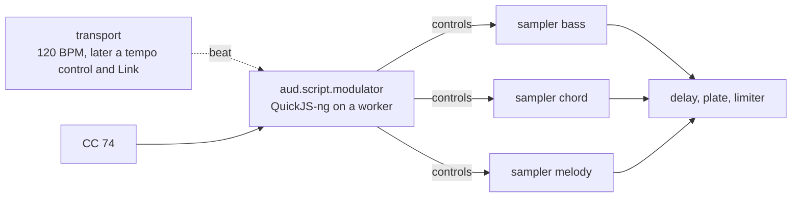

# 31: S29c — Port the SoundPrism Link Edition combis and their JavaScript LFOs

Status: planned 2026-10-14 on the user's request ("create a concept for
taking these presets over into Audanika"), on top of ticket 28; the open
questions of the plan review were answered the same day. Plan check
against tickets 29, 30 and 32 on 2026-10-18; implementation started the
same day.

## Goal

The Audanika app plays the 23 visible combis of SoundPrism Link Edition —
bass, chord and melody, each with its samples and its tempo-locked filter,
gain and pan patterns — on iOS and Android on the new engine, and they
sound as they did in SoundPrism. The patterns come from the original
JavaScript scripts, which run unchanged in a modulator node with a
JavaScript engine. That node lives in an optional package that apps add
explicitly, so that the engine, the umbrella and every other app stay free
of a JavaScript engine. Serves
[flutter-audio-kit](../goals/flutter-audio-kit.md) through the app
integration of S29a; refines scope-002 and app-001, which load no legacy
format at run time. What SoundPrism does is described in
[soundprism-link-edition](../concepts/topics/soundprism-link-edition.md).

## What the code base gives

- The app plays one sampler node per MIDI channel (app-002) into the
  master delay, plate and limiter (app-003). Its sounds are SFZ files that
  `tool/convert-content-bundle.js` rebuilt once from the legacy package
  (app-001), listed in `content/sfz/index.json`. The same converter
  dropped the scripts, which were never active in the legacy app.
- The graph connects event outputs to event inputs; a node with
  `AUD_NODE_CAP_EVENT_OUTPUT` sends `AUD_EVENT_CONTROL` with a float value
  and a sample offset. The sampler maps a control (0 to 511) onto sfizz's
  controllers, which SFZ maps onto cutoff, resonance, amplitude and pan
  (`*_onccN`).
- The transport snapshot per block gives the beat position (time-001);
  the internal clock is the default, Link plugs in as a provider later
  (link-001). The app does not start the transport yet.
- Nothing ramps a control over a buffer by itself. The graph ramps only
  parameters (`AUD_EVENT_PARAM`); the sampler hands a control to sfizz at
  its sample offset (`hdcc`). sfizz draws each controller per sample as a
  line from its value at the start of the block to each event and holds
  it after the last one (`linearEnvelope`): an event at offset 0 is a
  step, an event at the last frame a ramp over the whole buffer, an
  event at offset k a ramp over the first k frames. `<target>_smoothccN`
  adds a one-pole smoothing. Volume, amplitude and pan follow per sample;
  the filter takes a new cutoff every 16 frames (`filterControlInterval`).
- SoundPrism set its Apple Audio Units once per buffer ("immediate");
  whether the LowPass filter and the mixer smooth such changes inside is
  not documented and not measured.
- sfizz's own LFOs reproduce only about 29 of the 73 envelopes; the eased
  curves, the jumps, the arithmetic between envelopes and the range rules
  of SoundPrism have no SFZ form (see the topic).
- SoundPrism has one delay and one reverb for all channels, after the sum
  of the channels; a channel has only its low-pass, gain and pan. The
  scripts' `reverb.dryWet()` and `delay.dryWet()` are never read. The
  reverb preset `AUD002021_3_HighReverb` stays selected when a combi
  loads, so all combis share its settings — as the app's master chain
  does (app-003).
- No package runs JavaScript. `aud_audio_link` shows the pattern for a
  package that apps add explicitly and that the engine never depends on.

## Concept

- **A new optional package `aud_audio_script`** offers the node
  `aud.script.modulator`. It runs the scripts on QuickJS-ng (MIT, an
  interpreter in C), bundled, on every platform. A thin engine interface
  keeps the door open for the engine a platform already has
  (JavaScriptCore on iOS and macOS, the system WebView's V8 on Android);
  it is used only if QuickJS-ng misses the budget (scope 3). Like
  `aud_audio_link` the package is never a dependency of `aud_audio`, the
  umbrella or any other package; an app that wants scripts adds it.
- **QuickJS-ng lives in the C++ backend.** The node's C++ code embeds
  QuickJS-ng and calls it directly from its own worker thread; Dart is
  never in the path of a tick. Dart only creates the node, connects its
  outputs and hands it the script sources as a string setting, once per
  load, like the SFZ text of the sampler; there is no FFI call per tick.
  So the headless host and the plugin shells run scripts without Dart
  too.
- **The node is generic.** Scripts see a small API: a tick handler with
  beat, tempo and the playing state; the values of its event input
  (controls); `control(port, id, value)` to send a control on an event
  output; `console.log`. The number of outputs is a setting. The node
  knows nothing about SoundPrism.
- **One tick per audio buffer, as in SoundPrism.** The node follows the
  buffer size of the operating system and computes new values once per
  buffer, in step with the audio callback: at the end of a callback the
  audio thread hands the incoming controls to the worker and signals it
  (a non-blocking semaphore signal); the worker runs the script for one
  beat-grid point inside the next buffer and puts the values into a
  lock-free ring; the next callback sends them. How a value enters the
  buffer is a setting per output: a linear ramp over the buffer (one
  event at the last frame, which sfizz turns into a ramp per sample; the
  value arrives one buffer later), or a step (the old value one frame
  before the beat-grid point, the new one at it, so sfizz does not ramp).
  Default: the ramp, unless the measurements show that it costs too much
  (answer 18); then the step, as in SoundPrism.
  JavaScript never runs on the audio thread. A late worker holds the last
  value and is counted. The offline renderer waits for the worker, so
  renders are deterministic. A script load builds a new context on the
  worker and swaps at a tick; a failed load keeps the old one. A memory
  limit and a time budget per tick stop a runaway script.
- **The Audanika host layer in JavaScript** (`audanika-host.js`, in the
  app's content) recreates what SoundPrism's Objective-C interface did:
  `sampler.time` from the beat (`linkTime` = beat × 0.5), the slider from
  CC 74, the load order (`DefaultSamplerScript.js`, `DefaultSoundScript.js`
  per channel, the three channel scripts in one shared scope),
  `sampler.update()` per tick, and per channel the range rules of cutoff,
  resonance, gain and pan. It sends the results as controls to the three
  sampler nodes. The 72 scripts and both default scripts ship unchanged.
- **The samples and channel presets are converted once**, as in app-001
  and in the layout of ticket 32: per sample set an SFZ instrument from
  the reduced sets (every sixth semitone, as SoundPrism shipped them) with
  the samples as FLAC; per channel preset a channel SFZ that includes its
  set and adds the attack, release, gain and transposition of the preset,
  the pan per key that `noteOnPanorama` returns (it depends on the note
  only; a `<curve>` over sfizz's note-number controller, `pan_oncc133`,
  so the regions of the set stay shared), sfizz's 2-pole low-pass per
  voice, and the mappings of the modulator's controls onto cutoff,
  resonance, amplitude and pan. The controls use numbers from 300 on,
  clear of the MIDI controllers (0 to 127) and of sfizz's extended ones
  (128 to 137: pitch bend, aftertouch, velocity, note number and more).
- **The play modes stay as they are** (the user, 2026-10-18): the app
  keeps its own play modes and its channels — bass on MIDI channel 1,
  chord on 2, melody on 3, the channels the combis' presets expect. The
  play-mode variants of the edition are not converted.
- **The app** creates the modulator next to the three sampler nodes,
  connects its outputs, loads the scripts of a combi with its SFZ files,
  runs the transport at 120 BPM from the start of the engine — beat 0 —
  for as long as the engine runs (a tempo control follows in ticket 33),
  routes CC 74 from external MIDI to the modulator and starts it at the
  preset's value (the slider of the app follows later), and plays every
  combi through the master delay and plate with the settings of
  SoundPrism's reverb preset.

Approaches not taken:

- Translating the scripts into a declarative modulation program for a
  native node without JavaScript: no engine, but 72 scripts of code
  (products, `if`, state shared between channels) to translate and prove
  equal by sampling; every new script needs the translator again. The
  fallback if no engine meets the budget on the Galaxy Tab S4.
- sfizz's LFOs only: about 29 of 73 envelopes.
- A bundled JavaScriptCore or V8 on Android: several megabytes in the app.

## Scope

1. **The package `aud_audio_script`**, created like the repos of S00
   (ticket 2): QuickJS-ng with its notice behind the engine interface,
   compiled into the C++ backend through the package's build hook; the
   node with worker, semaphore, ring and event outputs; a thin Dart API
   (`AudScriptModulator`: type id, settings, the script sources) that
   only configures the node; native tests (no allocation and no lock on
   the audio thread, ThreadSanitizer, the late worker, deterministic
   offline renders) and a bench entry.
2. **A Node reference** in `audanika_app`: the original scripts run in
   Node's `vm` with a stub `sampler` on the same tick grid and write the
   control streams of every combi for a fixed scenario (120 BPM, CC 74
   moves, 32 bars, the buffer sizes of the devices). The modulator with
   the host layer must reproduce them within a tolerance (QuickJS-ng and
   V8 may differ in the last bits of `sin`).
3. **The measurements of QuickJS-ng**, before the app is wired:
   - Workloads: a synthetic script in `aud_audio_script` (envelopes and
     target functions like the combis', plus a tenfold stress variant),
     public; the 23 real combis with `audanika-host.js` in `audanika_app`,
     since the scripts are not public.
   - Numbers per device: the time of a tick (mean, p99, maximum) against
     the buffer duration, late ticks, context creation and the load of a
     combi, memory per context, the longest pause over 10 minutes
     (garbage collection), the size QuickJS-ng adds to the app.
   - On the worker thread of the node, not on the main thread: ticket 28
     found the audio thread of the Galaxy Tab S4 about ten times slower
     than a bench on the main thread.
   - Devices: the reference devices of release-004 (Galaxy Tab S4, iPad
     Pro (M5), iPhone 16 Pro Max), the iOS simulator and the Android
     emulator; Node (V8 with JIT) on the Mac as the baseline.
   - The real-world comparison goes to the user as a table: QuickJS-ng
     per device against the buffer durations of the device, beside
     JavaScriptCore on the iPad and the iPhone (the engine SoundPrism
     ran on) and Node on the Mac. The user decides what counts as fast
     enough (answer 15). If QuickJS-ng is, it stays on every platform;
     if not, the WebView's V8 (`JavaScriptSandbox`, in a process of its
     own) is measured on Android too, and the engine per platform is
     decided with the user.
4. **The converter** `tool/convert-soundprism-link-edition.js` in
   `audanika_app`: reads the content packages from a path given on the
   command line and writes into `content/`:
   - the 46 sample sets from the reduced packages, decoded from m4a and
     stored as FLAC, in the layout of ticket 32;
   - the channel SFZ files of the 69 channel presets of the 23 combis;
   - the scripts, the two default scripts and `audanika-host.js`;
   - the combis in `index.json`: channels, scripts, the start value of CC
     74, delay and reverb from `AUD002021_3_HighReverb`.
   It shares the sample rules of `convert-content-bundle.js`.
5. **The app**: the modulator in `AudSoundEngine`, the event connections,
   the transport at 120 BPM from the start of the engine, CC 74 from
   external MIDI to the modulator, the combis in the sound list.
6. **Measurements** in the app on the same devices: the CPU time of the
   worker and of the node on the audio thread, late ticks, memory per
   script context, load time of a combi (FLAC decoding included), app
   size; the cost of the ramp against the step (the render time of the
   three sampler nodes with the densest combi on the Galaxy Tab S4,
   since a ramp turns sfizz's constant controller blocks into curves per
   sample); a listening comparison with SoundPrism, ramp against step; a
   recording of a gating combi from SoundPrism on a device, if one still
   runs it, shows whether its Audio Units smoothed the steps.

## Affected repos (expected)

- `aud_audio_script` (new): the package, QuickJS-ng, the node, the
  synthetic benchmark; 0.1.0.
- `audanika_app`: the reference, the measurements of the real combis, the
  converter, the content, the wiring.
- `aud_dsp_sampler`, only if a finding needs it: controls that arrive
  over event connections, a resonance of −10 dB (one preset) below
  sfizz's range.
- `aud_audio_pm`: this plan, the topic, the decisions, the new package in
  `architecture.md` and `packages.jsonc`, the step in the plan of ticket
  17.

## Steps

1. Plan review (done 2026-10-14); write the decisions.
2. Create `aud_audio_pm`'s entries for the new package; create the repo
   `aud_audio_script` with the user.
3. The Node reference and the control streams of all combis.
4. QuickJS-ng in the package on iOS, Android and macOS; the node, the
   worker, the semaphore and the ring; native tests.
5. The host layer; the modulator reproduces the reference in an offline
   render.
6. The measurements of QuickJS-ng on all devices with JavaScriptCore and
   Node beside it; the table goes to the user, who decides the budget.
7. The converter, after ticket 32: samples as FLAC, channel SFZ, per-key
   pan, mappings, `index.json`; level matched as in app-001.
8. The app; first combi end to end on both platforms, then all 23.
9. Measurements and listening; decisions from the findings; code review,
   review, publish.

## Answers of the plan review (2026-10-14)

1. The package is `aud_audio_script`, the node `aud.script.modulator`.
2. QuickJS-ng on all platforms; measure; if the scripts run fast enough,
   QuickJS-ng stays.
3. `audanika-host.js` lives in the app's content.
4. The tick follows the buffer size of the operating system: new values
   every buffer, in step with the audio callback.
5. Fidelity as in SoundPrism: one value per buffer, no smoothing; how it
   enters the buffer, ramp or step, is answer 18.
6. The filter is sfizz's, per voice, driven by controls.
7. The reduced sample sets (every sixth semitone) as FLAC; the WAVs of
   the app's other sounds switch to FLAC too (ticket 32).
8. The 23 visible combis.
9. 120 BPM; a tempo control is planned as ticket 33.
10. The slider of the app comes later; until then CC 74.
11. The play-mode variants are migrated too; only the default variant is
    used for now. Superseded on 2026-10-18: the play modes stay as they
    are, the variants are not converted (plan check, 9).
12. The samples and patches of SoundPrism Link Edition ship with the
    Audanika app.
13. Delay and reverb come from SoundPrism's reverb preset, on the app's
    master chain; SoundPrism has no delay or reverb per channel either.
14. QuickJS-ng is called directly from the C++ backend, not through
    Dart.
15. What counts as fast enough is decided after the measurements: the
    real-world comparison is shown to the user, who is asked again
    (scope 3).
16. Beat 0 is the start of the engine; the transport runs for as long as
    the engine runs.
17. The default variant applies only while a Link Edition combi plays;
    it changes the sound, nothing on the interface. Superseded on
    2026-10-18 with answer 11.
18. A ramp over the buffer, if it is not too expensive; otherwise the
    step (answer 5 then holds).

## Plan check against tickets 29, 30 and 32 (2026-10-18)

Confirmed by the user on 2026-10-18; point 9 was changed by the user.

1. **The filter per voice is a new cost.** With a filter, mono regions
   leave the fused pass of sampler-009; sfizz's filter designs its
   coefficients every 16 frames and computes a `pow` per sample even
   when nothing moves. The voice costs of ticket 30, the start budgets
   of lifecycle-004 and the budgets the app learned (app-005) come from
   presets without filters, so a combi may overload briefly after it
   loads; the governor lowers the budget. Measured; a hold check in
   sfizz's filter is the finding that would bring `aud_dsp_sampler` in.
2. **Ramp and step.** Cutoff and resonance cost the same either way. Gain
   goes to `amplitude_onccN` (linear, like SoundPrism's mixer volume),
   not `volume_onccN` (dB, a `pow` per sample on a ramp); then only pan
   costs a few passes more on a ramp. sfizz turns an event at offset k > 0
   into a ramp over the frames before it, so the step sends the old value
   at k − 1 and the new one at k, as planned. Measured (answer 18).
3. **The worker on the fast cores.** Since io-003 the Android audio thread
   runs on the fast cores; the worker would land where the system puts
   it, on the Galaxy Tab S4 likely the small cores. It binds itself to the
   fast cores with an audio priority on Android (the core detection of
   `aud_audio_io` is not exported, so the package keeps a copy) and asks
   for the user-interactive class on Apple platforms; measured.
4. **The node owns its worker.** interop-001 says the engine owns every
   worker thread; the tasks of lifecycle-002 do not fit (two shared
   workers without order, shared with the sampler's reads). script-001
   records the node's own worker next to the semaphore signal.
5. **Offline renders.** A node learns per block that it renders offline
   (`AUD_PROCESS_OFFLINE`); then it waits for its worker inside
   `process`, with the RealtimeSanitizer off around that wait.
6. **Gauge and governor** time the audio thread only; the worker's CPU
   time is measured on its own.
7. **Transport.** Nothing starts it, and a stopped graph keeps its beat:
   the app seeks to 0 and starts it at every start of the engine.
8. **CC 74.** External MIDI reaches only the `external` node; the app
   connects every external input to the modulator too. The slider reads
   CC 74 of the first MIDI channel, as in SoundPrism.
9. **Play modes** (changed by the user): no `sml`; the app's channels stay
   as they are — bass 1, chord 2, melody 3 — and the variants are not
   converted.
10. **The content.** All reduced sample sets are m4a, 25 of the 46 at
    22 kHz without `sampleInfo.xml`; the app's converter rejects them.
    The new converter decodes and encodes with macOS's `afconvert` (no
    `flac` or `ffmpeg` on the Mac) and runs on macOS. Android's
    `noCompress` gets flac (sampler-004 inflates compressed assets).
11. **Ticket 32** is planned, not started; the package, the reference and
    the measurements do not wait for it; the user is asked when the
    converter is due.
12. **Numbers and setup.** The app decision is app-006 (ticket 29 took
    app-005). `create-family-repos.js` takes the dependency ranges of the
    new package from its entry. `aud_dsp_effects` is the pattern of the
    package (hooks, `test-native.js` with ASan, RTSan and TSan, a C bench
    entry). One tick runs per render call, the audio callback: 180 frames
    on the Galaxy Tab S4, 256 on the iPhone, 512 on the simulator.

## Open questions

1. Open until the measurements (answer 15): the budget for QuickJS-ng,
   proposed as the p99 of a tick at most 10 % of the buffer duration and
   no late tick in 10 minutes of the densest combi on the Galaxy Tab S4;
   and what "too expensive" means for the ramp (answer 18).

## Out of scope

Ableton Link (S15) — the modulator follows any transport provider, so
Link plugs in without changes; the tempo control (ticket 33); the slider
of the app; an editor for scripts, scripts written by users and scripts
loaded from outside the app; the other SoundPrism editions; the play-mode
variants of the edition (plan check, 9); the web, where the browser's own JavaScript could run scripts in
the worklet later.

## Decisions this plan proposes

- script-001: JavaScript runs only in the optional package
  `aud_audio_script`, on QuickJS-ng embedded in the node's C++ backend
  behind an engine interface and called directly by a worker of the node
  that computes once per audio buffer — never from Dart, never on the
  audio thread; the audio thread only signals the worker without
  blocking. The worker is the node's own thread, an exception to
  interop-001. The engine and the umbrella never depend on the package.
- app-006 (app-005 went to ticket 29): the SoundPrism Link Edition combis are rebuilt once as SFZ
  with FLAC samples; their scripts ship unchanged and run in
  `aud.script.modulator` behind the host layer `audanika-host.js` — the
  one legacy format the app reads at run time (refines scope-002 and
  app-001).

## Model and rules

Claude Opus 5.5 at extra high effort (process-004); the standing rules of
process-005. The signal of the worker from the audio thread is a system
call that does not block; script-001 records it next to process-005's
rule of no lock on the audio thread.

## Rests on

scope-002, app-001, app-002, app-003, sampler-001, sampler-003, time-001,
link-001, lifecycle-002, interop-001, family-002, release-004, process-003,
process-004, process-005; the bench finding of ticket 28; tickets 32 and
33; topics soundprism-link-edition, legacy-audio-engine, sfizz.
