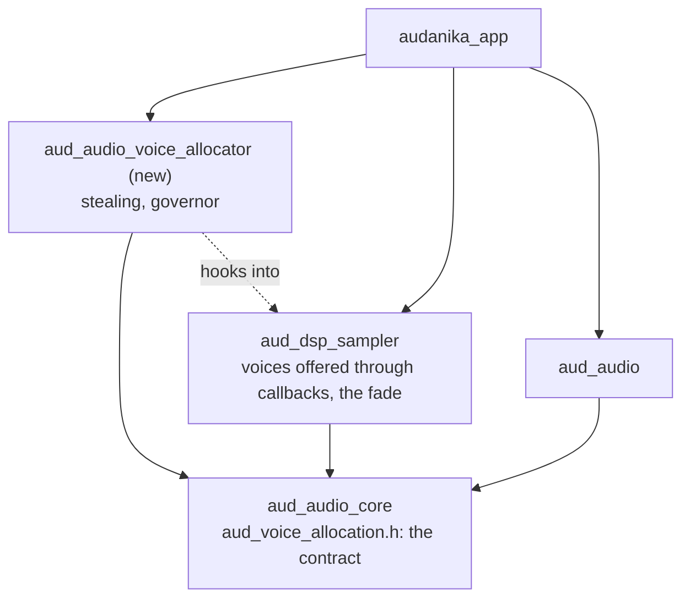

# 34: S9d — Move the voice stealing and the governor into aud_audio_voice_allocator

Status: planned 2026-10-15 during ticket 30, on the user's request ("plan
a ticket that moves the voice stealing and the governor to a separate
package & repo"). Plan review on 2026-10-15; not started. Runs after the
last of the tickets 30 to 39 (answer 7).

## Goal

The voice stealing and the load governor live in one package of their
own, `aud_audio_voice_allocator`, instead of being spread over
`aud_dsp_sampler` and the umbrella `aud_audio`. The allocator decides
everything about stealing — the budget of the process, the share of each
node, which voices go — and the instruments only offer their voices
through callbacks and fade out what the allocator picks. The sampler
today, the synthesizer of `aud_dsp_synth` and other voice-based nodes
later share the one budget of the process and steal by the same rules;
the allocator knows no instrument and no instrument knows the allocator,
and it depends on `aud_audio_core` only.
Players hear and see no change: the governor reaches the budgets of
tickets 29 and 30 and the stress test keeps zero xruns after settling.
Serves [flutter-audio-kit](../goals/flutter-audio-kit.md) and
lifecycle-001 (instrument nodes bound their polyphony and steal voices);
moves what sampler-008 and lifecycle-003 placed.

## What the code base gives

Ticket 29 built the pieces in three repos (sampler `6fbaf9f`, `aud_audio`
`c6d718b`, app `66d639e`):

- **The budget of the process** (`aud_dsp_sampler`,
  `src/aud_sfz_voice_budget.hpp/.cpp`, 250 lines, no sfizz code): the
  atomics of the budget, the reserve, the sounding and released voices,
  the nodes and the counters; `limitExcess` and `budgetShare`, the share
  of the excess per node. A constant-initialized static in the sampler's
  library. Each package builds a library of its own with hidden symbols,
  so a synthesizer in another package could not share this budget today.
  Its only tie to the sampler is `AudSfzVoiceStats` of `aud_dsp_sampler.h`.
- **The node glue** (`src/aud_sfz_node.cpp` 1001–1065 and hooks in
  `process`, `prepare`, reset and destroy): counts the voices of the
  active and the fading synth, steals, publishes or withdraws; the
  parameter `max_voices`.
- **The mechanics in the fork** (`Voice`, `VoiceManager`, `Synth`,
  `VoiceCount.h`): `VoiceManager::stealVoices` orders the voices —
  released first, then the oldest, the layers of a note together, sorted
  into a buffer without allocation — and `Voice::steal` fades a voice out
  over 10 ms and makes it ignore note offs and pedals.
- **The API of the sampler**: five C exports, `AudDspSampler.voiceBudget`,
  `.voiceReserve` and `.voiceStats` with `@RecordUse` (`hook/link.dart`),
  the Dart `AudSfzVoiceStats`.
- **The governor** (`aud_audio`, pure Dart, about 1 100 lines without the
  tests): `AudLoadBudget`, `AudLoadPolicy` (no timers, replays recorded
  samples), `AudLoadGovernorConfig`, `AudLoadGovernorState`,
  `AudLoadGovernor` (an `AudEngineExtension`) and `AudDeviceClass` (reads
  the system through the C library with `dart:ffi`, a web stub, no build
  hook). It needs `AudEngine` and `AudEngineExtension` of `aud_audio`,
  `AudGraph.renderLoad` and `AudGraphLoad` of `aud_audio_graph` and the
  xruns of `aud_audio_io`. Nothing else in `aud_audio` and no other
  package of the family uses it.
- **The app** binds both: `SamplerVoiceBudget` (an `AudLoadBudget` over
  `AudDspSampler.voice*`), `AudSoundEngine._govern`, `VoiceBudgetMemory`,
  the developer panel, and two integration tests
  (`voice_budget_sweep_test.dart`, `effects_numbers_test.dart`) that set
  `AudDspSampler.voiceBudget` and step the policy directly.
- **A budget across libraries** exists once: the sample cache budget of
  lifecycle-002, owned by `aud_audio_graph` and reached by the nodes
  through `AudHostApi` of ABI 0.4. A new member of the host API means ABI
  0.5 and new builds of every native package, which sampler-008 avoided.
- **The layers of the family**: the DSP packages depend on
  `aud_audio_core` only (family-001); the core holds the contracts
  between packages.
- No other package steals voices; `aud_dsp_synth` is still the template.
- Versions: `aud_audio_core` 0.5.2, `aud_dsp_sampler` 0.3.2, `aud_audio`
  0.4.2, which pins core, graph, io and web exactly (against family-002),
  `aud_audio_midi` 0.1.3 asks `aud_audio ^0.4.2`.
- Ticket 30 works on the same code: its sampler branch `30-voices`
  rewrites `VoiceManager` around `stealVoices`, and its step 6 raises the
  start budgets of `AudDeviceClass` in `aud_audio`.

## Answers of the plan review (2026-10-15)

1. The package is `aud_audio_voice_allocator`.
2. The sampler offers callbacks and the voice allocator hooks in; the
   allocator is as independent as possible (the user: "Sampler offers
   call back methods, the voice allocator can hook in").
3. The order of stealing moves too: the allocator picks the voices.
4. The old members leave `aud_dsp_sampler` and `aud_audio` at once, with
   minor versions; the app is their only user.
5. The allocator depends on `aud_audio_core` only: the governor reads an
   interface of its own instead of `AudEngine`, and the app writes the
   adapter to the engine.
6. A node without an allocator steals nothing beyond sfizz's own
   polyphony; `max_voices` takes effect through the allocator.
7. The ticket runs after the last of the tickets 30 to 39.

## Proposal

- **The contract in `aud_audio_core`**: a header `aud_voice_allocation.h`
  with two structs, each with `struct_size`. `AudVoiceSourceApi` is what
  an instrument node offers: its voices as candidates (an id, the note
  they belong to, released or held, the start time) written into a buffer
  the caller owns, its own limit (`max_voices`), and `steal` for a note.
  `AudVoiceAllocatorApi` is the hook: the node calls it once per block
  after its events with its source, and when it stops sounding (destroyed,
  reset, offline). Both run on the audio thread: no allocation, no lock.
  It is not part of `AudHostApi`; the ABI stays at 0.4.
- **The allocator** (`aud_audio_voice_allocator`) implements the hook in
  its own library, which exists once per process: the budget, the reserve
  and the counters of `aud_sfz_voice_budget.*`, the share of each node,
  and the order of `VoiceManager::stealVoices` — released first, then the
  oldest, all voices of a note together. Its Dart API `AudVoiceAllocator`
  (limit, reserve, `AudVoiceStats`, `hookInto`) is an `AudLoadBudget`
  itself, so the app's adapter to the sampler goes away.
- **The governor** moves with the policy, the configuration, the state
  and `AudDeviceClass`, with their names. It no longer knows the engine:
  it reads an `AudLoadSource` of the package — the mean, p99 and maximum
  share of the block over a window, the overloads, the xruns, the block
  and the sample rate — and is started, stopped and told of new timing by
  whoever owns it. `AudLoadGovernorState` carries the package's own
  `AudLoadReading` in place of `AudGraphLoad`. The policy runs without
  timers as before, so recorded samples still replay through it.
- **The sampler** offers its voices: the node implements
  `AudVoiceSourceApi` over its active and its fading synth and calls the
  hook it was given. It keeps the parameter `max_voices`, which the
  allocator reads, and the fade of a stolen voice in the fork.
  `AudDspSampler.voiceHook` is the address of its C function that installs
  an allocator; without one the node steals nothing (answer 6).
- **The app** connects them before the engine starts
  (`AudVoiceAllocator.process.hookInto(AudDspSampler.voiceHook)`) and
  writes the adapter of the governor: an `AudEngineExtension` that starts,
  stops and retimes the governor with the engine and an `AudLoadSource`
  over `AudGraph.renderLoad`, the stream's xruns and its format, about 40
  lines. Neither the sampler nor `aud_audio` knows the allocator; the
  allocator knows no instrument and no engine.

## Scope

1. **The contract** (`aud_audio_core`): the header, a test that compiles
   it as C and as C++, the README.
2. **The package `aud_audio_voice_allocator`**, created like the repos of
   S00 (ticket 2, repos-001): `flutter create --template=package_ffi`, the
   `dna_audanika` layer, `index.jsonc`, README in English and German, the
   quick check and the ruleset; a build hook for its library, a link hook
   with `@RecordUse`, a neutral library without `dart:ffi` and an FFI
   library (web-001).
3. **The allocator**: the budget, the share and the counters moved from
   the sampler, the order moved from the fork, over the contract; native
   tests with a fake source — the tests of ticket 29 that need no sfizz,
   the order (released first, oldest, whole notes, ties by start time and
   id), several sources on one thread and on two; asan, tsan, rtsan; no
   allocation and no lock on the audio thread. The C exports,
   `AudVoiceAllocator` and `AudVoiceStats`.
4. **The sampler as a source**: the node offers its voices and calls the
   hook; `VoiceManager` lists its voices as candidates and steals a note
   by id with its layers instead of ordering them; the budget, its five C
   exports, `AudDspSampler.voiceBudget`, `.voiceReserve`, `.voiceStats`
   and `AudSfzVoiceStats` leave; `voiceHook` joins the `@RecordUse`
   members. The node tests of ticket 29 (two graphs, two threads) run
   with the allocator compiled from its sources, as
   `scripts/test-native.js` compiles the graph today (a dev dependency).
   The goldens of the fork stay bit for bit.
5. **The governor moved**: the six files of `aud_audio` on
   `AudLoadSource` instead of `AudEngine`; their tests on a fake source
   (today the governor's test runs `AudEngineFfi` on the null device);
   the web fixture, the README sections. `aud_audio` drops them and its
   exact pins become caret constraints (family-002); otherwise the app
   could not resolve `aud_audio_core` 0.5.3. `aud_audio_midi` widens its
   constraint to the next minor of `aud_audio`.
6. **The app**: the adapter of the governor to `AudEngine` with the test
   that ran in `aud_audio` (the null device); the imports, the hook,
   `_govern` over `AudVoiceAllocator.process`, `SamplerVoiceBudget`
   removed, `VoiceBudgetMemory`, the panel on `AudLoadReading` and the
   tests on the new package; the integration tests and
   `tool/measure-voices.js` on `AudVoiceAllocator`.
7. **Acceptance**: every test of ticket 29 passes at its new place; the
   voice sweep and the stress test on the Galaxy Tab S4 and the iOS
   simulator give the budgets, the stolen voices and the zero xruns after
   settling of the final numbers of ticket 30, within the noise of a run;
   the render time of the sampler nodes does not grow by the callbacks.

## Affected repos (expected)

- `aud_audio_voice_allocator` (new): the allocator, the governor, the
  device class; 0.1.0.
- `aud_audio_core`: the contract; a patch (0.5.2 → 0.5.3).
- `aud_dsp_sampler`: the source and the hook in, the budget and the order
  out; a minor, since public members leave.
- `aud_audio`: the governor out, the pins as carets; a minor (0.4 → 0.5).
- `aud_audio_midi`: the constraint on `aud_audio`; a patch.
- `audanika_app`: the adapter of the governor, the wiring, the tests,
  the measurements.
- `aud_audio_pm`: this plan; a decision lifecycle-004 that supersedes the
  place of the budget and the order in sampler-008 and of the governor in
  lifecycle-003; the package in `packages.jsonc` and `architecture.md`;
  S9d in the plan of ticket 17.

## Steps

1. Plan review (done 2026-10-15).
2. After the last of the tickets 30 to 39 is published: the package in
   `packages.jsonc` and `architecture.md`; create the repo
   `aud_audio_voice_allocator` with the user
   (`scripts/create-family-repos.js`, `scripts/setup-github-repo.js`),
   refresh the ocean, `gg do add`.
3. The contract in `aud_audio_core`.
4. The allocator with its native tests over a fake source, and its API.
5. The sampler as a source; `VoiceManager` without the order; the node
   tests with the allocator; the goldens.
6. The governor from `aud_audio`; the pins; `aud_audio_midi`.
7. The app; the sweep and the stress test on the tablet and the
   simulator.
8. Decision lifecycle-004, review, publish in the order of the
   dependencies: core, the allocator, the sampler (whose tests use the
   allocator), `aud_audio`, `aud_audio_midi`, the app.

## Open questions

None. The plan review on 2026-10-15 answered them (above).

## Out of scope

A synthesizer on the allocator (`aud_dsp_synth`); budgets of other
resources (the governor stays general over `AudLoadBudget`); any change
of the policy, its thresholds or the start budgets; per-node render times.

## Model and rules

Claude Opus 5.5 at extra high effort (process-004); the standing rules of
process-005.

## Rests on

sampler-008, lifecycle-001, lifecycle-002, lifecycle-003, app-005,
family-001, family-002, repos-001, build-001, abi-001, interop-001,
web-001, process-004, process-005; the plans of tickets 29 and 30.
