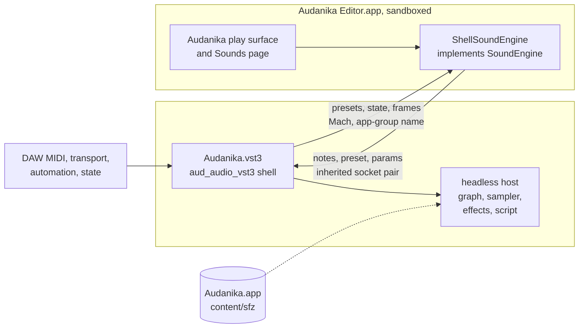

# 37: S18 — Ship Audanika as a Mac app with its VST3 plugin inside

Status: planned 2026-10-20 on the user's request ("Als nächstes soll
Audanika als VST Plugin zur Verfügung gestellt werden … Bitte bringe
Audanika mit Hilfe von aud_audio_vst3 soweit, dass es als VST Plugin
fungiert"); confirmed by the user the same day, with the answers below.

## Goal

Musicians play Audanika inside their DAW. The Audanika app comes to the Mac
through TestFlight and the Mac App Store, and it carries a VST3 instrument
built on `aud_audio_vst3`: the DAW plays Audanika's presets from its MIDI
tracks, the plugin window shows Audanika's play surface, and a project
keeps the preset and settings. No separate installer is needed; one consent
step in the app makes the plugin visible to the DAWs (plugin-005). The
ticket does the macOS part of S18 (the VST3 shell, ticket 17) and of S3b
(the desktop audio IO), Apple silicon only (release-005). Serves
[flutter-audio-kit](../goals/flutter-audio-kit.md) through its first user,
the app (ticket 27).

## Requirements

- [req-mac-001](../../requirements/mac.md#req-mac-001-mac-app-on-testflight-and-the-mac-app-store)
  (must): the Mac app on TestFlight and the Mac App Store
- [req-mac-002](../../requirements/mac.md#req-mac-002-the-vst3-plugin-comes-with-the-mac-app)
  (must): the VST3 plugin comes with the Mac app
- [req-mac-003](../../requirements/mac.md#req-mac-003-the-plugin-plays-audanikas-sounds-from-the-daw)
  (must): the plugin plays Audanika's sounds from the DAW
- [req-mac-004](../../requirements/mac.md#req-mac-004-the-plugin-shows-the-audanika-ui-as-its-editor)
  (should): the Audanika UI as the plugin's editor — wanted from the start
  of the editor work, no preset-only editor in between (the user,
  2026-10-20)
- [req-mac-005](../../requirements/mac.md#req-mac-005-the-plugin-is-built-on-aud_audio_vst3)
  (must): the plugin is built on `aud_audio_vst3`

## What the code base gives

- `aud_audio_vst3` 0.1.0 is the spike of ticket 24, not a product: one
  `SingleComponentEffect` named "Aud Spike", a stereo output and an event
  input it never reads, the graph's built-in nodes only (no sampler,
  effects or script node), a graph document compiled in as a string, arm64
  only, signed ad hoc. What holds: stable parameter ids, state as the graph
  document, the control thread per instance, the symbol hygiene of
  plugin-004, the SDK validator (13 bundles pass), and the editor of
  plugin-003 — a Flutter app in its own process, frames over IOSurfaces and
  Mach, commands over a Unix socket in `$TMPDIR`. Its pins of graph and core
  (`^0.4.0`) are behind the family (graph 0.5.3, core 0.5.2).
- `aud_audio_auv3` holds the iOS spike only; `aud_audio_clap` is empty.
- `aud_audio_io` 0.3.4 has no macOS device: the hook builds only the null
  device for macOS (`aud_io_null.cpp`), the vendored miniaudio serves only
  `aud_io_ios.mm`. Core, graph, sampler, effects, script and the MIDI
  bridge already build and test on macOS; `aud_midi_apple` has CoreMIDI.
- The headless host of `aud_audio_graph` (plugin-002) gives the shells what
  they need: `aud_host_load`/`save`, node presets through
  `aud_host_apply_preset`, an asset table against a base directory, stable
  parameter ids, latency and tail, `aud_host_render` with events and
  transport, `aud_host_wait_loads`; packages register through
  `aud_graph_host_api`.
- `audanika_app` 4.4.1+168: `macos/` is the untouched Flutter template
  (`com.example.audanika`, no team, sandbox only). On macOS the app is
  silent (`SoundEngine.isSupported` is iOS and Android), looks for its SFZ
  content next to the executable instead of in `Contents/Resources`, marks
  every album as bought (`content_item_iap_connector.dart`) and uses a mock
  store. The engine is built in Dart (`AudSoundEngine`): a sampler node per
  MIDI channel 1 to 3 (bass, chord, melody), `external` for external MIDI
  (app-002), `modulator` (`aud.script.modulator`), then delay, plate reverb
  and limiter (app-003); 28 presets in `content/sfz/index.json`, 110 MB of
  content; the voice governor runs in Dart (app-005). The UI reaches the
  engine only through the `SoundEngine` interface — the seam an editor in
  another process needs.
- iOS ships as `com.audanika` (team SAZSC68S46, App Store app 1547307555)
  with `flutter build ipa` and `fastlane deliver`; the app-specific
  password comes from the keychain. No macOS lane, no Mac metadata, no Mac
  distribution certificates on the development Mac yet.

## Concept

### Distribution (plugin-005)

DAWs look for VST3 plugins only in `~/Library/Audio/Plug-Ins/VST3` and
`/Library/Audio/Plug-Ins/VST3`. The plugin lives inside the app and is
updated with it; the app's step "Activate the plugin" asks the user to pick
the plug-in folder in an open panel and places a symbolic link to the
embedded plugin there. App Review Guideline 2.4.5 (ii) forbids installing
code in shared locations, so the ticket retires that risk first: the gate
(step 3) validates the bundle with App Store Connect and tries the link in
the DAWs before the plugin is built out; internal TestFlight testers need
no App Review. If App Review refuses the step later, the same plugin ships
as a notarized Developer ID package (a ticket of its own).

### Bundle

```text
Audanika.app/Contents/
|-MacOS/Audanika                    the app, App Sandbox
|-Frameworks/                       Flutter, the family's native assets
|-Resources/content/sfz/            the SFZ content, once (110 MB)
|-PlugIns/Audanika.vst3/Contents/   the plugin (place confirmed by the gate)
  |-MacOS/Audanika                  shell + graph + sampler + effects +
  |                                 script, arm64, entry points only
  |-Resources/                      graph document, presets, moduleinfo
  |-Helpers/Audanika Editor.app     the editor, App Sandbox
```

The plugin finds the content through its resolved path inside the app, and
through the app's bundle id when it was installed apart from it (the
fallback package).

### Processes



- **Engine in the DAW.** The shell runs the headless host with one graph
  document that has the app's topology: `channel-0` to `channel-2`
  (sampler), `external` (sampler), `modulator` (script), `delay`,
  `reverb`, `limiter`. An Audanika preset is a set of node presets — SFZ
  per node, script text, effect values — applied with
  `aud_host_apply_preset`, so a preset change crossfades as in the app
  (sampler-003). Document and presets are exported from the app's Dart
  code at build time, so app and plugin sound alike. The voice budget is
  fixed until ticket 34 moves the governor into the engine.
- **MIDI.** The DAW's notes, poly and channel pressure, pitch bend and
  controllers (through `IMidiMapping`) become render events at their
  sample offsets; channels 1 to 3 play bass, chord and melody as the app's
  own MIDI does, the other channels play `external` as external MIDI does
  in the app (app-002). The notes played on the editor's surface also
  leave the plugin through an event output, so a MIDI track can record
  them (Cubase and REAPER; Live takes no MIDI from a VST3). The host's
  transport
  (`ProcessContext`) drives the graph's transport, which the scripts and
  the tempo delay follow.
- **Parameters and state.** The preset as a stepped parameter and a program
  list; delay mix, reverb mix, the master volume and the script controls of
  the combis (300 to 303: cutoff, resonance, linear gain, position, app-006)
  as automatable parameters; the state stores the preset and the parameter
  values with a version, restored without the editor.
- **Editor (plugin-003, in the sandbox).** A second macOS target of the app,
  "Audanika Editor", built from `lib/main_plugin_editor.dart`: a slim
  composition root with the play surface and the Sounds page, without IAP,
  mediathek, push or MIDI ports. Its `ShellSoundEngine` implements
  `SoundEngine` over the shell protocol: notes from the surface go into the
  plugin's event queue and sound in the next block; preset choices and
  parameters go to the plugin, which pushes its presets and state back. The
  native runner of the spike's editor (frames, input forwarding, accessory
  mode, multi-view) becomes a reusable part of `aud_audio_vst3`. A
  sandboxed process may not reach the spike's socket in `$TMPDIR` nor look
  up arbitrary Mach names, so the plugin hands the editor a socket pair
  when it spawns it and registers its Mach name with the app group's prefix
  (`SAZSC68S46.com.audanika.*`); no file in a group container is touched,
  which would make macOS ask the user for access. Logs go to the unified
  log instead of `~/Library/Logs`.

### The Mac app

The app gets a real macOS target: bundle id `com.audanika` (the iOS app
record gains the macOS platform — universal purchase, the albums bought on
iOS hold on the Mac), team SAZSC68S46, App Sandbox with the entitlements
the features need (Bluetooth and network for MIDI, user-selected files and
bookmarks for the plugin step), the music category, purpose strings, the
icon, the content in `Contents/Resources`. `aud_audio_io` gets its macOS
device on miniaudio's Core Audio backend; the app turns its sound engine on
for macOS, uses StoreKit for real, and switches off the motion sensors.

## Affected repos

- `aud_audio_pm`: the requirements `mac`, this plan, the decisions
  plugin-005 and release-005 and those the steps settle, the ticket in
  `issues.md`, the architecture; later the blog post.
- `aud_audio_io`: the macOS device — `src/aud_io_macos.mm` on miniaudio's
  Core Audio backend, the device list and default-device changes, the
  latency and timestamps of time-001, the hook building it; a minor
  version.
- `aud_audio_vst3`: from spike to shell — identity from a configuration,
  the node packages compiled in and registered, DAW MIDI and transport,
  presets and program list, state, content lookup, the editor runner as a
  reusable part, the sandbox-safe protocol, signing with hardened runtime,
  spike leftovers removed, graph and core 0.5; a minor version (0.x).
- `audanika_app`: the macOS target and its release lane, sound on macOS,
  StoreKit on macOS, the export of the plugin's document and presets, the
  plugin configuration and build, the editor target and its entry point,
  the plugin inside the app, the step "Activate the plugin"; a minor
  version.
- Added when a step needs them, as process-005 says: `aud_audio_graph` (a
  real-time entry for sample-accurate automation, open work of
  plugin-002), `aud_dsp_sampler`, `aud_dsp_effects`, `aud_audio_script`
  (source manifests the shell's build reads, if their hooks carry flags of
  their own). `aud_audio`, `aud_audio_midi` and `aud_audio_web` came in
  with `gg do add` as dependencies and leave the ticket if they keep no
  change of their own.

## Steps

Phase A — the Mac app and the gate:

1. This plan, the requirements, plugin-005 and release-005; the user
   reviews and confirms.
2. `audanika_app`: the macOS target — bundle id, team, sandbox
   entitlements, category, purpose strings, icon, the content copied into
   `Contents/Resources` and found there, a minimum window size; the app
   starts on the Mac (still silent).
3. Gate: the spike's plugin, renamed and signed for real, with a sandboxed
   editor, embedded in the app; archive and export for the Mac App Store
   and `altool --validate-app` (the user's credentials); the link placed
   by hand; Cubase 15 and REAPER find and load the plugin from the link,
   and the sandboxed editor connects. Settles the place in the bundle,
   the signing order and the editor's channels (plugin-006); a refusal by
   the validation is decided with the user before anything else is built.

Phase B — the Mac app plays:

4. `aud_audio_io`: the macOS device, its tests on the Mac, the example
   playing; the hook builds it for macOS (decision io-004).
5. `audanika_app`: the sound engine on macOS, StoreKit instead of the mock
   and no free albums, motion sensors off, MIDI on the Mac (virtual ports,
   network sessions), play with mouse and trackpad; the user plays the app
   on the Mac before the plugin work goes on.

Phase C — the plugin plays Audanika:

6. `aud_audio_vst3`: the shell — identity, version, `moduleinfo.json` and
   class id from a configuration; probe, test parameter, driver and skew
   check removed; graph and core 0.5; sampler, effects and script compiled
   from their sources and manifests (build-001) and registered, every
   symbol hidden (plugin-004); DAW events and `IMidiMapping` into render
   events; the host transport; latency and tail; content lookup;
   presets, program list and state; native tests, the test host and the
   validator.
7. `audanika_app`: the exporter of the graph document and the 28 presets
   from the app's own engine code; the plugin configuration and a build
   tool; an offline render of each preset by app engine and plugin
   compared (decision app-009).
8. REAPER and Cubase: a MIDI clip plays every preset, automation, save and
   reopen, offline render, two instances, ten minutes without a dropout;
   memory and CPU recorded.

Phase D — the Audanika editor:

9. `aud_audio_vst3`: the editor runner as a reusable part, the channels of
   step 3 (plugin-006), the protocol for notes from the editor, the preset
   list and choice, state pushes and parameters; the logs in the unified
   log.
10. `audanika_app`: `lib/main_plugin_editor.dart` with its slim
    composition root, `ShellSoundEngine`, the target "Audanika Editor"
    built into the plugin's `Helpers`.
11. The embedding checklist of plugin-003 in REAPER and Cubase: resizing,
    Retina, focus and keys, wheel, cursor, open and close a hundred times,
    two instances; memory per editor and CPU of an animated surface.

Phase E — ship:

12. `audanika_app`: plugin and editor built into `Audanika.app` and signed
    inside out; "Activate the plugin" and "Deactivate" in the settings
    (open panel, link, bookmark, status, repair after the app moved).
13. `audanika_app`: the macOS release lane — build, archive, export,
    validate, upload (only on the user's go), Mac metadata and
    screenshots; an internal TestFlight build installed on the Mac and
    tried in Cubase and REAPER, Live if its trial is installed.
14. The submission to App Review is the user's decision; the fallback
    package follows in a ticket of its own if App Review refuses the
    plugin step.
15. `/code-review`, documentation (blog posts, `index.jsonc`, READMEs, the
    architecture), review, publish; the requirements set to `done`.

## Answers of the plan review (2026-10-20)

Before the plan, the user chose:

- **Distribution:** the VST3 inside the app with the fallback package
  (plugin-005), over an AUv3 in the store and over two distributions.
- **Editor:** the Audanika UI from the start of the editor work, no
  preset-only editor in between.
- **Macs:** Apple silicon only (release-005).
- **Requirements:** req-mac-001 to req-mac-005 as derived from the request.

At the review:

1. **DAW MIDI:** channels 1 to 3 play bass, chord and melody, every other
   channel plays `external` (app-002).
2. **MIDI from the editor:** yes — an event output sends the surface's
   notes to the DAW.
3. **Automatable parameters:** preset, delay mix, reverb mix, master volume
   and the script controls of the combis.
4. **Tickets:** one ticket, a commit per phase; phases D and E may still
   move to follow-up tickets if phase C takes longer.

## Findings

- **Step 2 (2026-10-20).** The macOS target builds with Flutter 3.47.5 and
  Xcode 27.1: arm64 only, signed by the team with the hardened runtime,
  sandboxed, 293 MB in debug of which 112 MB are the SFZ content in
  `Contents/Resources/content/sfz`; every native asset of the family
  (core, graph, io, midi, script, effects, sampler, `gg_quickjs`,
  `aud_midi_apple`) builds for macOS. The app starts and shows the play
  surface, still silent.
- **Gate, the sandboxed editor's channels (2026-10-20).** A probe played the
  plugin in an unsandboxed parent and spawned a helper app signed with the
  App Sandbox and the app group `SAZSC68S46.com.audanika`: the helper runs in
  its own container, looks up a Mach name with the group's prefix (0) but
  not one without it (1100, not privileged), and reads and writes the end of
  a socket pair it inherited as fd 3, also when it opens `/dev/fd/3` — which
  is how `dart:io` reaches it. This carries plugin-006: a socket pair at
  spawn and Mach names with the group's prefix, no file anywhere.
- **Gate, the link (2026-10-20).** A spike plugin inside the app's
  `Contents/PlugIns`, linked into `~/Library/Audio/Plug-Ins/VST3`, is
  found by REAPER 7 through the link ("VST3i: Aud Spike D1 (no hygiene)
  (Audanika)") and renders 2256 blocks without an overload. Cubase 15 and
  the validation by App Store Connect are open (open question 1).
- **Step 4 (2026-10-20).** `aud_audio_io` plays on macOS
  (`src/aud_io_macos.mm`, io-004): the devices of the HAL with route,
  channels and rates — on the development Mac a Sennheiser USB headset as
  the default, the built-in speakers and microphone, two virtual devices —
  and the package's sine on the default output at 48 kHz and 256 frames,
  283 callbacks in 1.5 s, no xrun. The 40 native tests and the 64 Dart
  tests pass; `aud_audio_core` and `aud_audio_graph` joined the ticket,
  which the example of `aud_audio_io` needs.
- **Step 5 (2026-10-20).** The app plays on the Mac
  (`integration_test/sound_numbers_test.dart -d macos`): content found in
  `Contents/Resources` in 35 ms, the default preset loaded in 21 ms,
  10.6 ms from command to sound (8.8 to 12.2), 100 notes in 5 s without an
  xrun or a late callback, at most 0.14 ms of render time, 7.4 ms output
  latency. StoreKit replaces the mock store on macOS; debug builds on the
  Mac show every album, as the simulator does. The governor starts at 64
  voices on macOS (the default class of `AudDeviceClass`) and rises with
  the load.

## Open questions

1. **App Store Connect.** The app record 1547307555 needs the macOS
   platform (universal purchase; it ends a "Designed for iPad" offer on
   Apple silicon Macs, if one is switched on), and the Mac needs the
   distribution certificates — through Xcode's automatic signing with the
   user's account, or created by the user. Both are needed by step 3.

## Out of scope

- Intel Macs, Windows and Linux (release-005, S3c, S3d, S18).
- AUv3 on macOS and the CLAP shell (S19, S20).
- The fallback package outside the store (only if App Review refuses).
- Sample-accurate automation, unless REAPER's tests show the block
  granularity of the spike is audible (then `aud_audio_graph` joins).
- Note expressions and MPE from the DAW; the voice governor in the plugin
  (ticket 34).
- Audio input and tone recognition on the Mac.

## Decisions

Recorded at planning:

- [plugin-005](../concepts/decisions/plugin-005.md) (accepted): the VST3
  inside the Mac App Store app, linked into the plug-in folder after the
  user's consent; fallback package if App Review refuses.
- [release-005](../concepts/decisions/release-005.md) (accepted): macOS
  joins with the Mac app, Apple silicon only.

Expected from the steps: io-004 (the macOS device), plugin-006 (the
sandboxed editor's channels and the place in the bundle), app-009 (the
plugin's presets exported from the app), app-010 (DAW MIDI and the
editor's notes).

## Model and rules

Claude Opus 5.5 at extra high effort (process-004); the standing rules of
process-005. Measurements run on the development Mac (Apple M5) in REAPER
and Cubase 15; uploads to App Store Connect happen only on the user's go.

## Rests on

plugin-001 to plugin-005, ui-003, release-001, release-003, release-005,
io-001, time-001, app-002, app-003, app-005, app-006, build-001,
build-002, process-004, process-005; tickets 17 (S18, S3b), 23, 24, 27
and 31; the research of 2026-10-20: App Review Guidelines 2.4.5 and 2.5.2
(<https://developer.apple.com/app-store/review/guidelines/>), Steinberg's
plug-in locations
(<https://steinbergmedia.github.io/vst3_dev_portal/pages/Technical+Documentation/Locations+Format/Plugin+Locations.html>),
the DTS answers on plugins from sandboxed apps
(<https://developer.apple.com/forums/thread/760318>), Moog's Model D as a
store app with an AUv3 and a separate VST3.
