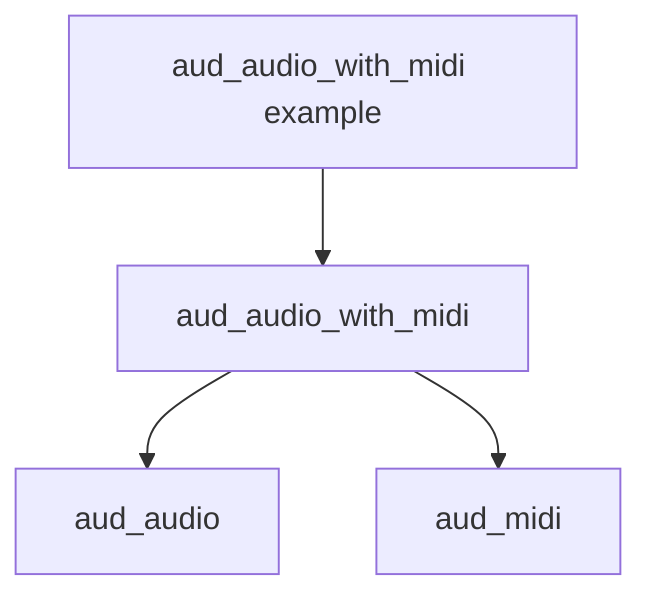

<!--
@license
Copyright (c) Audanika. All Rights Reserved.

Use of this source code is governed by terms that can be
found in the LICENSE file in the root of this package.
-->

# The name says the layer

## Motivation

- `aud_audio_midi` sits one layer above `aud_audio`: it depends on it and
  adds the ports of `aud_midi`. The name read like a part of `aud_audio`.
- Ticket `decouple_aud_audio_midi` planned the rename as a follow-up.

## Strategy

- Rename the package to `aud_audio_with_midi`
  ([req-framework-003](../../requirements/framework.md): the package graph
  names the package by its role).
- Decision with the user: the C symbols and the header follow the package
  name; the node type IDs `aud.midi.*` stay, so saved graphs stay valid.

## Implementation

- `aud_audio_with_midi`: package, repo (GitHub keeps a redirect), files,
  C API and example renamed.
- `aud_audio` and `aud_audio_graph`: docs and `usedBy` follow.
- This repo: `packages.jsonc`, the architecture, the package graph, the
  decisions and the open tickets use the new name. Done tickets, blog
  posts and the review of ticket 40 keep the old name: they describe what
  was true then.
- `audaudiohub.io` names the package nowhere; nothing changed there.

## Result

- The ticket plan is marked implemented with its decisions; tests of the
  renamed package are green.

## Open Points

- The local folders of the workspace still carry the old name until the
  next fresh clone.
