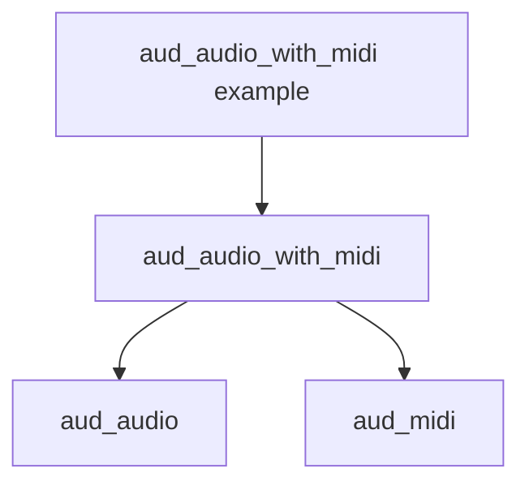

<!--
@license
Copyright (c) Audanika. All Rights Reserved.

Use of this source code is governed by terms that can be
found in the LICENSE file in the root of this package.
-->

# Der Name nennt die Schicht

## Motivation

- `aud_audio_midi` liegt eine Schicht über `aud_audio`: Es hängt davon ab
  und ergänzt die Ports von `aud_midi`. Der Name klang wie ein Teil von
  `aud_audio`.
- Ticket `decouple_aud_audio_midi` hatte die Umbenennung als Folgeticket
  geplant.

## Strategie

- Das Paket in `aud_audio_with_midi` umbenennen
  ([req-framework-003](../../../requirements/framework.md): der
  Paketgraph benennt das Paket nach seiner Rolle).
- Entscheidung mit dem Nutzer: C-Symbole und Header folgen dem Paketnamen;
  die Node-Typ-IDs `aud.midi.*` bleiben, gespeicherte Graphen bleiben
  gültig.

## Umsetzung

- `aud_audio_with_midi`: Paket, Repo (GitHub leitet weiter), Dateien,
  C-API und Example umbenannt.
- `aud_audio` und `aud_audio_graph`: Doku und `usedBy` ziehen nach.
- Dieses Repo: `packages.jsonc`, Architektur, Paketgraph, Entscheidungen
  und offene Tickets nutzen den neuen Namen. Erledigte Tickets, Blogposts
  und das Review aus Ticket 40 behalten den alten Namen: Sie beschreiben
  den damaligen Stand.
- `audaudiohub.io` nennt das Paket nirgends; dort ändert sich nichts.

## Ergebnis

- Der Ticket-Plan ist mit seinen Entscheidungen als umgesetzt markiert; die
  Tests des umbenannten Pakets sind grün.

## Offene Punkte

- Die lokalen Ordner des Workspaces tragen den alten Namen bis zum
  nächsten frischen Klon.
