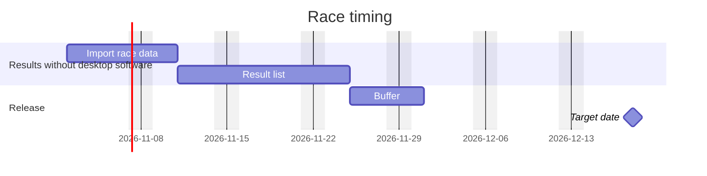

<!--
@license
Copyright (c) Audanika. All Rights Reserved.

Use of this source code is governed by terms that can be
found in the LICENSE file in the root of this package.
-->

# Schedule guide

How the time plan of a project is made: the requirements are cut into
tickets, each ticket is estimated, and the result is drawn as a Gantt
chart.

## Know what the schedule is

- One file for the whole project, kept across quarters:
  `doc/schedule.md`
- A forecast, not a promise: it shows when the work is likely done and
  whether a target date holds
- Optional: a project plans with it only when the user wants one
- It rests on accepted requirements. Without them, run
  `/plan-requirements` first

## Set the frame with the user

Ask one question at a time and propose a default each time:

- Target date — optional. Without one, plan forward from the start and
  report the end date that results
- Start — default: the next working day
- Capacity — who works on the project and how many days per week;
  default: `doc/team/people.md`, if the repo has it
- Blocked times — holidays, vacations, other projects
- Scope — which goals; default: all active ones

## Cut the work into tickets

- Group the accepted requirements that are not `done` into tickets. One
  ticket is one step that can be delivered on its own, ideally one to five
  working days; split bigger ones
- Give each planned ticket a title in English kebab case, the
  requirements it fulfils, the repos it will likely touch and the tickets
  it waits for
- Add the work no requirement names but the plan needs: setup,
  migrations, releases, documentation
- Reuse existing ticket files with their IDs. A planned ticket gets a
  ticket file only when it is planned for real, see the
  [PM repo guide](pm-repo-guide.md#plan-a-ticket)

## Estimate each ticket

- Estimate in working days of one person: optimistic `o`, likely `l`,
  pessimistic `p`
- Expected duration: `(o + 4 * l + p) / 6`, rounded up to half days
- Base the numbers on the requirements, the code repos (their `index.md`)
  and finished tickets of the past, and say what each one rests on
- Add a buffer of 20 % of the expected sum as a bar of its own at the end;
  never hide buffer inside the tickets
- Show the estimates to the user before drawing the chart. Their numbers
  win

## Lay out the plan

- Order the tickets by what they wait for, then by priority: `must`
  before `should` before `could`
- Work tickets in parallel only when more than one person is available
- With less than five days per week, stretch each duration accordingly:
  three days per week turn five working days into a bit more than eight
  calendar working days
- Leave out weekends and blocked times
- Compare the end with the target date. If the `must` tickets and the
  buffer do not fit, say so plainly and offer options: move `could` and
  `should` tickets behind the date, move the date, add capacity, or cut a
  requirement. The user decides; never shrink estimates to make the plan
  fit

## Write the schedule

Use this template:

````markdown
# Schedule

## Frame

- Target date: 2026-12-18
- Start: 2026-11-02
- Capacity: one developer, four days per week
- Forecast: done by 2026-11-30, 14 working days before the target date

## Gantt



## Tickets

| Ticket           | Requirements    | o / l / p  | Expected | After  |
| ---------------- | --------------- | ---------- | -------- | ------ |
| import-race-data | req-results-002 | 3 / 5 / 8  | 5.5 d    | —      |
| result-list      | req-results-001 | 5 / 7 / 12 | 7.5 d    | import |

## History

- 2026-10-19: first plan
````

- One section per goal, one bar per ticket. The bar ID is a short form of
  the ticket title, so `after` can refer to it
- Bar length: the expected duration, stretched to the capacity and
  rounded up to whole days
- Mark finished tickets `done` and running ones `active`, e.g.
  `Import race data :done, import, 2026-11-02, 7d`
- One `milestone` at the target date, if there is one

## Keep it alive

- Update the schedule when a ticket is finished: mark it `done` and note
  how long it really took
- Re-plan when estimates prove wrong, requirements change or the capacity
  changes, and update the forecast
- Never rewrite the history: add a line with the date, what changed and
  why
- Check the forecast against the target date at every quarter planning
